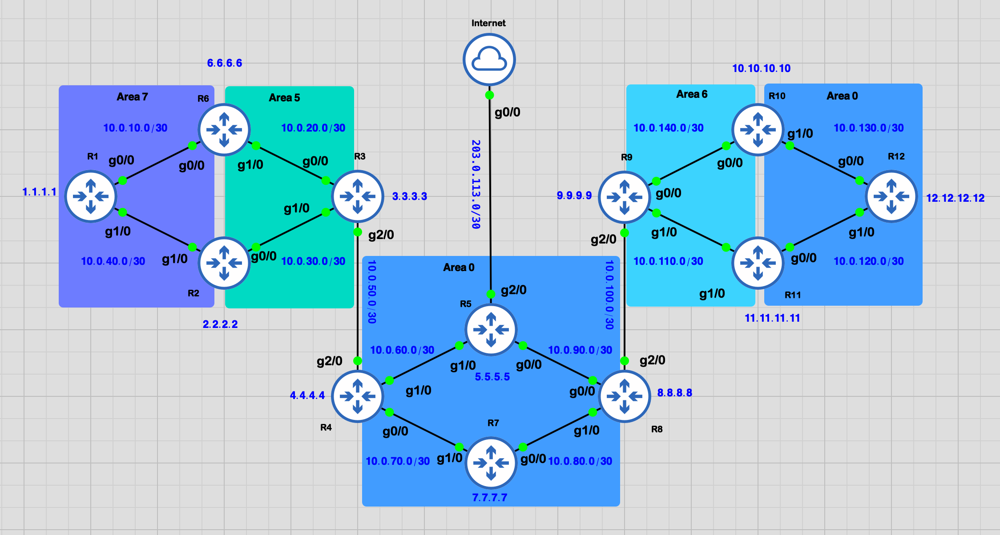
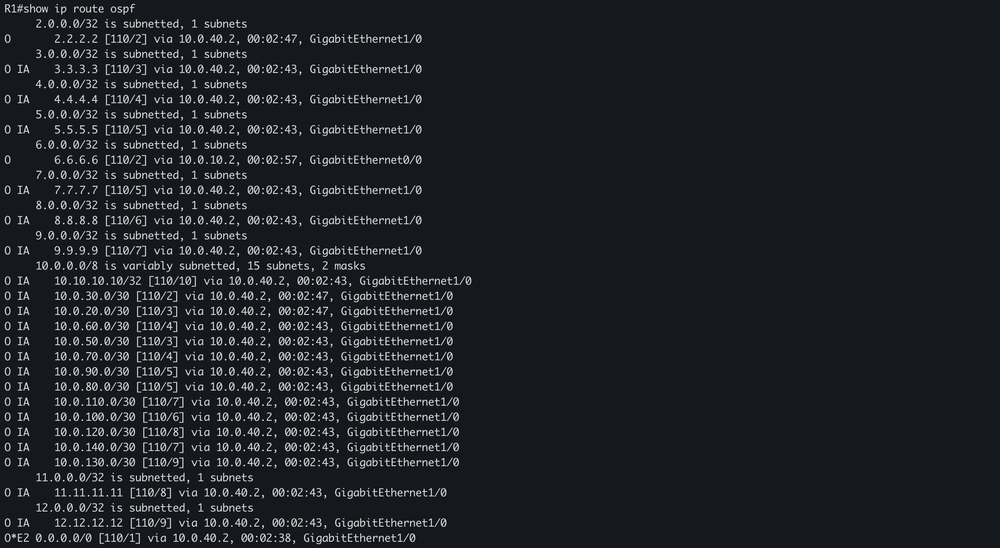
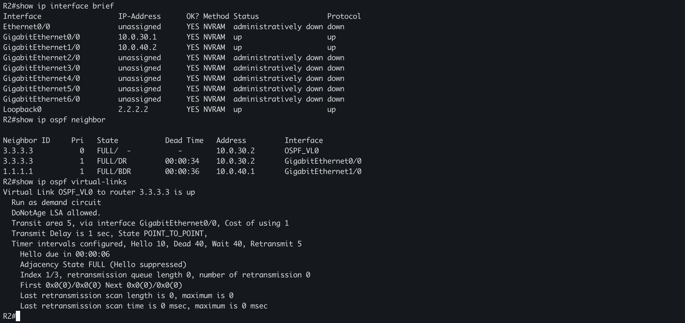
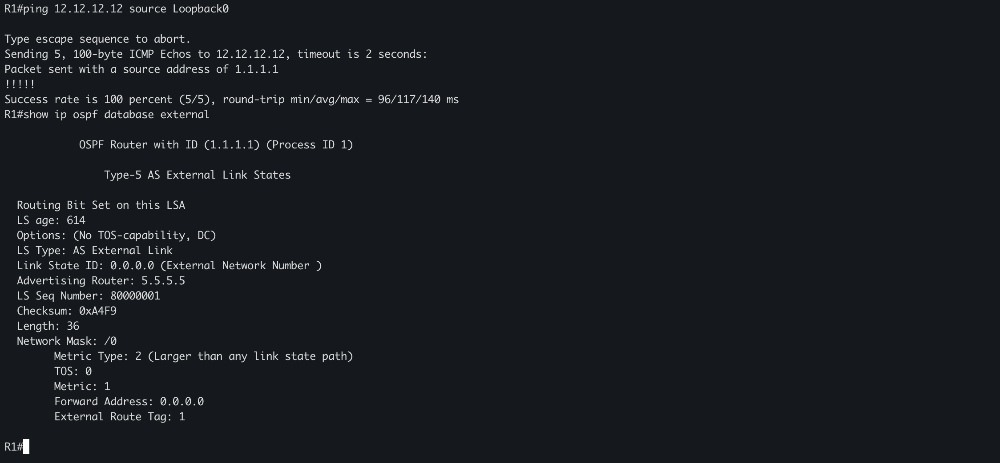

# Multi-Area OSPF Routing Lab | Cisco IOS + GNS3


## Overview

A practical multi-area **OSPFv2 routing laboratory** built in **GNS3** using Cisco IOS routers. The design explores OSPF neighbor discovery, SPF, the link-state database, Area Border Routers (ABRs), non-contiguous Area 0, OSPF virtual links, static default routes, and OSPF external route origination.

The core contains **12 OSPF routers** plus **R13**, a simulated ISP router attached to R5. R13 is an extension for static routing and default-route experiments; it **does not run OSPF**. A possible second ISP (R14) was discussed but **is not part of this version**.

> **Project status:** The topology and reference configurations are documented, and a cleaned native `.gns3project` archive is included under [`gns3-project/`](gns3-project/). A FULL R2–R3 virtual adjacency was demonstrated in console output, but the entire 13-router configuration has **not** been independently verified end-to-end. Cisco IOS images are not distributed here.

## Network topology



The screenshot shows two physically disconnected portions of **Area 0**. They have the same Area ID, but require a logical backbone connection across **transit Area 6**. Similarly, **Area 7** is separated from the backbone by **Area 5**.

### OSPF areas and roles

| Area | Router connections | Notes |
|:---|:---|:---|
| **7** | R1–R2, R1–R6 | Non-backbone area on left |
| **5** | R2–R3, R6–R3 | Transit area for left virtual link |
| **0** (center) | R3–R4, R4–R5, R4–R7, R5–R8, R7–R8 | Central backbone |
| **6** | R8–R9, R9–R10, R9–R11 | Transit area for right virtual link |
| **0** (right) | R10–R12, R11–R12 | Same logical Area 0, disconnected physically |

R2 and R6 attach Areas 7 and 5; R3 attaches Areas 5 and 0; R8, R10 and R11 attach Areas 6 and 0. A working virtual link gives R2 a logical backbone connection so that it can function as a proper ABR to Area 7.

### Virtual links

| Endpoints | Transit area | Why |
|:---|:---:|:---|
| R2 (`2.2.2.2`) ↔ R3 (`3.3.3.3`) | 5 | Logically attach Area 7 to Area 0 |
| R8 (`8.8.8.8`) ↔ R11 (`11.11.11.11`) | 6 | Connect central and right Area 0 segments |

The R2–R3 virtual adjacency reached **FULL** on `OSPF_VL0` in an observed R2 console output. The R8–R11 virtual link is also confirmed **up** with adjacency state **FULL** in the captured R8 console output. These screenshots document the observed state at capture time; additional end-to-end testing remains outside this evidence set.

## Addressing plan

All router-to-router OSPF transit links use a `/30` mask (`255.255.255.252`). Loopbacks use `/32` identifiers, except the optional simulated ISP test loopback on R13.

| Link | Network | Endpoint A | Endpoint B | Area |
|:---|:---|:---|:---|:---:|
| R1 Gi0/0 ↔ R6 Gi0/0 | `10.0.10.0/30` | `10.0.10.1` | `10.0.10.2` | 7 |
| R6 Gi1/0 ↔ R3 Gi0/0 | `10.0.20.0/30` | `10.0.20.1` | `10.0.20.2` | 5 |
| R2 Gi0/0 ↔ R3 Gi1/0 | `10.0.30.0/30` | `10.0.30.1` | `10.0.30.2` | 5 |
| R1 Gi1/0 ↔ R2 Gi1/0 | `10.0.40.0/30` | `10.0.40.1` | `10.0.40.2` | 7 |
| R3 Gi2/0 ↔ R4 Gi2/0 | `10.0.50.0/30` | `10.0.50.1` | `10.0.50.2` | 0 |
| R4 Gi1/0 ↔ R5 Gi1/0 | `10.0.60.0/30` | `10.0.60.1` | `10.0.60.2` | 0 |
| R4 Gi0/0 ↔ R7 Gi1/0 | `10.0.70.0/30` | `10.0.70.1` | `10.0.70.2` | 0 |
| R7 Gi0/0 ↔ R8 Gi1/0 | `10.0.80.0/30` | `10.0.80.1` | `10.0.80.2` | 0 |
| R5 Gi0/0 ↔ R8 Gi0/0 | `10.0.90.0/30` | `10.0.90.1` | `10.0.90.2` | 0 |
| R8 Gi2/0 ↔ R9 Gi2/0 | `10.0.100.0/30` | `10.0.100.1` | `10.0.100.2` | 6 |
| R9 Gi1/0 ↔ R11 Gi1/0 | `10.0.110.0/30` | `10.0.110.1` | `10.0.110.2` | 6 |
| R11 Gi0/0 ↔ R12 Gi1/0 | `10.0.120.0/30` | `10.0.120.1` | `10.0.120.2` | 0 |
| R10 Gi1/0 ↔ R12 Gi0/0 | `10.0.130.0/30` | `10.0.130.1` | `10.0.130.2` | 0 |
| R9 Gi0/0 ↔ R10 Gi0/0 | `10.0.140.0/30` | `10.0.140.1` | `10.0.140.2` | 6 |
| R5 Gi2/0 ↔ R13 Gi0/0 | `203.0.113.0/30` | `203.0.113.1` | `203.0.113.2` | Outside OSPF |

R1–R12 Loopback0 addresses: `1.1.1.1/32` through `12.12.12.12/32`, respectively. Some of these numeric loopback addresses overlap real public address space and are intended **only for this isolated lab**. The `192.0.2.0/24`, `198.51.100.0/24`, and `203.0.113.0/24` blocks are reserved for documentation (RFC 5737), **not actual Internet access**.

## Key OSPF concepts covered

- **Link-state routing:** OSPF exchanges link-state advertisements (LSAs) and calculates shortest paths using Dijkstra's SPF algorithm.
- **Neighbor adjacency:** Hello packets, neighbor states, DR/BDR behavior on broadcast interfaces.
- **ABR:** Routers that exchange information between an attached non-backbone area and backbone Area 0.
- **Virtual link:** An Area 0 *logical point-to-point adjacency* carried across a non-backbone transit area; it doesn't create an Ethernet cable or turn the whole transit area into Area 0.
- **OSPF route types:** `O` intra-area, `O IA` inter-area, `O E1` and `O E2` external.
- **ASBR:** R5 can originate a default external route when it connects to the simulated ISP via R13.
- **Routing costs and redundancy:** Compare alternative paths and observe reconvergence following link shutdown.

For a step-by-step explanation, see [OSPF concepts](docs/ospf-concepts.md), [virtual links](docs/virtual-links.md), and [static default route + ASBR](docs/static-routing-asbr.md).

## Repository structure

```text
Multi-Area-OSPF-Routing-GNS3-Lab/
├── README.md
├── .gitignore
├── topology/
│   └── ospf-13-router-topology.png
├── configs/
│   ├── base/                  # Reference Cisco configurations R1–R12
│   │   ├── R1.cfg ... R12.cfg
│   └── extensions/
│       ├── R5-ISP.cfg        # Optional R5 uplink/default origination
│       └── R13-ISP.cfg       # Simulated ISP configuration
├── docs/
│   ├── ospf-concepts.md
│   ├── virtual-links.md
│   └── static-routing-asbr.md
├── verification/
│   ├── README.md
│   └── observed-R2-neighbors.txt
└── gns3-project/
    ├── Multi-Area-OSPF-Routing-GNS3-Lab.gns3project
    └── README.md              # Export contents and limitations
```

## How to run

1. Create a GNS3 project, place routers R1–R13, and connect interfaces following the topology.
2. Select compatible Cisco IOS router images with sufficient GigabitEthernet interfaces; adjust interface names for the selected appliance.
3. Paste the reference configurations from `configs/base/` into R1–R12. These are **reconstructed reference configs**, not verbatim `show running-config` exports.
4. Confirm `show ip interface brief` and basic pings on each directly connected `/30` link.
5. Verify `show ip ospf neighbor` until all expected physical adjacencies reach FULL.
6. Verify virtual links with `show ip ospf virtual-links` on both endpoints.
7. For the optional R13 ISP experiment, apply `configs/extensions/` and check static default-route origination.
8. Import [`gns3-project/Multi-Area-OSPF-Routing-GNS3-Lab.gns3project`](gns3-project/Multi-Area-OSPF-Routing-GNS3-Lab.gns3project), map a legally obtained local IOS image, and verify the topology before use. Do not distribute proprietary Cisco IOS images.

## Useful Cisco verification commands

```cisco
show ip interface brief
show ip ospf neighbor
show ip ospf interface brief
show ip ospf virtual-links
show ip ospf border-routers
show ip ospf database
show ip ospf database external
show ip route ospf
show ip route 0.0.0.0
ping 8.8.8.8
traceroute 12.12.12.12
```

> Some example loopbacks resemble globally assigned addresses. Do not interpret a successful lab ping to those addresses as real Internet connectivity.

## Recorded lab evidence

The shared verification captures show an established FULL adjacency over `OSPF_VL0` for both the R2–R3 Area 5 virtual link and the R8–R11 Area 6 virtual link, plus successful internal reachability and default-route advertisement. See the detailed [verification results](verification/README.md). This is **not** a claim that every router or every possible path has been validated.

## Lab Verification & Results

Selected Cisco IOS captures demonstrate the core OSPF results:

### OSPF routing table



R1 learns intra-area (`O`), inter-area (`O IA`), and external default-route (`O*E2 0.0.0.0/0`) entries.

### Virtual-link verification



R2 reports the R2–R3 virtual link through Area 5 as `up` with adjacency state `FULL`. The R8–R11 Area 6 virtual-link capture is included in the detailed verification report.

### Loopback connectivity and external LSA



R1 Loopback0 reaches R12 Loopback0 with 100% success, and the Type 5 default-route LSA identifies R5 (`5.5.5.5`) as the advertising router.

See [verification/README.md](verification/README.md) for all five screenshots, Cisco commands, explanations, and verification limitations.

## Future improvements

- Re-import the included `.gns3project` archive and record end-to-end verification results.
- Capture `show running-config` from every active router and replace reference configs where needed.
- Capture additional physical-neighbor and failover results from the remaining routers.
- Document OSPF LSA Types 1–5, DR/BDR elections, costs, summarization and failover.
- Extend to a second ISP router (R14), then experiment with competing default routes and backup paths.

## References

- [RFC 2328 — OSPF Version 2](https://www.rfc-editor.org/rfc/rfc2328)
- [RFC 5737 — IPv4 Address Blocks Reserved for Documentation](https://www.rfc-editor.org/rfc/rfc5737)

## Author

GitHub: [khalidhrch1](https://github.com/khalidhrch1)
