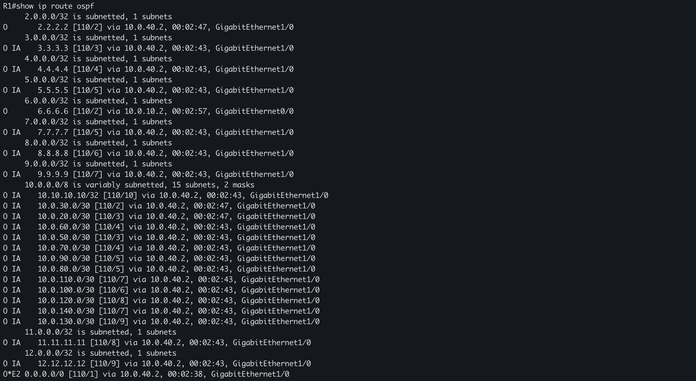
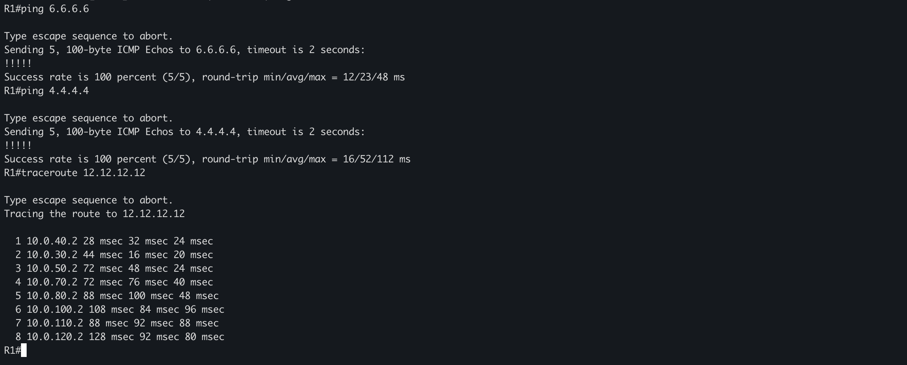
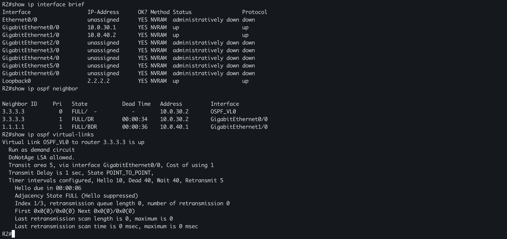
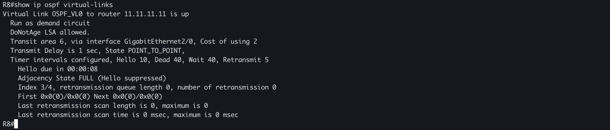
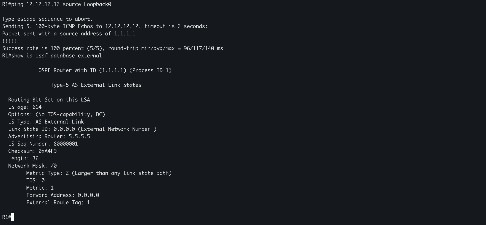

# OSPF Lab Verification Results

The screenshots in this directory are captured Cisco IOS CLI evidence from the lab. They document selected routing, reachability, virtual-link, and external-LSA results; they are not a claim that every router or every possible path has been tested.

## Verification summary

| Area | Observed result | Evidence |
| --- | --- | --- |
| OSPF route learning | R1 has intra-area (`O`) and inter-area (`O IA`) routes, including remote loopbacks and transit networks | [`r1-ospf-routing-table.png`](screenshots/r1-ospf-routing-table.png) |
| External default | R1 installs `O*E2 0.0.0.0/0` via `10.0.40.2` | [`r1-ospf-routing-table.png`](screenshots/r1-ospf-routing-table.png) |
| Internal reachability | R1 pings R6 (`6.6.6.6`) and R4 (`4.4.4.4`) with 100% success | [`r1-ping-traceroute.png`](screenshots/r1-ping-traceroute.png) |
| OSPF path selection | R1 traceroute reaches R12 (`12.12.12.12`) through the OSPF network | [`r1-ping-traceroute.png`](screenshots/r1-ping-traceroute.png) |
| Area 5 virtual link | R2–R3 virtual link is `up`; adjacency state is `FULL` on `OSPF_VL0` | [`r2-virtual-link-area5.png`](screenshots/r2-virtual-link-area5.png) |
| Area 6 virtual link | R8–R11 virtual link is `up`; adjacency state is `FULL` | [`r8-virtual-link-area6.png`](screenshots/r8-virtual-link-area6.png) |
| Loopback connectivity | R1 Loopback0 (`1.1.1.1`) pings R12 Loopback0 (`12.12.12.12`) with 100% success | [`r1-loopback-ping-external-lsa.png`](screenshots/r1-loopback-ping-external-lsa.png) |
| Type 5 external LSA | Default-route LSA is advertised by router `5.5.5.5`, confirming R5 as the OSPF default-route advertiser | [`r1-loopback-ping-external-lsa.png`](screenshots/r1-loopback-ping-external-lsa.png) |

## Captured evidence

### R1 OSPF routing table



Command:

```cisco
show ip route ospf
```

The output includes intra-area routes marked `O`, inter-area routes marked `O IA`, and the external default route `O*E2 0.0.0.0/0` via `10.0.40.2` on `GigabitEthernet1/0`. This demonstrates that R1 is receiving both internal OSPF reachability and an externally originated default.

### R1 reachability and traceroute



Commands:

```cisco
ping 6.6.6.6
ping 4.4.4.4
traceroute 12.12.12.12
```

Both R6 and R4 respond at 100% success (`5/5`). The traceroute reaches R12 through the observed next hops `10.0.40.2`, `10.0.30.2`, `10.0.50.2`, `10.0.70.2`, `10.0.80.2`, `10.0.100.2`, `10.0.110.2`, and `10.0.120.2`.

### R2–R3 virtual link through Area 5



Commands:

```cisco
show ip ospf neighbor
show ip ospf virtual-links
```

R2 shows R3 (`3.3.3.3`) as `FULL/-` on `OSPF_VL0`, while the physical Area 5 adjacency is also `FULL/DR`. The virtual link is explicitly reported as `up` through transit Area 5, confirming the logical backbone adjacency.

### R8–R11 virtual link through Area 6



Command:

```cisco
show ip ospf virtual-links
```

R8 reports the virtual link to router ID `11.11.11.11` as `up`, through transit Area 6, with adjacency state `FULL`. This confirms the right-side logical backbone connection.

### R1 Loopback0 connectivity and Type 5 external LSA



Commands:

```cisco
ping 12.12.12.12 source Loopback0
show ip ospf database external
```

The sourced ping from `1.1.1.1` to `12.12.12.12` succeeds at 100% (`5/5`). The external database output shows a Type 5 LSA for `0.0.0.0` with advertising router `5.5.5.5`, confirming R5's role in advertising the OSPF default route.

## Additional recorded evidence

The earlier sanitized R2 neighbor output is retained in [`observed-R2-neighbors.txt`](observed-R2-neighbors.txt).

## Not claimed by these screenshots

- ISP connectivity beyond the simulated R5–R13 lab edge was not validated here.
- Clean import and live startup of the `.gns3project` archive was not validated here.
- Full physical-neighbor, route, and reachability coverage for every router was not captured.

## Suggested collection commands

```cisco
show ip interface brief
show ip ospf neighbor
show ip ospf virtual-links
show ip ospf border-routers
show ip ospf database
show ip route ospf
show ip route 0.0.0.0
```

Save actual router outputs as sanitized text files in this directory. Avoid credentials, secrets, vendor binary images or unrelated personal files.
